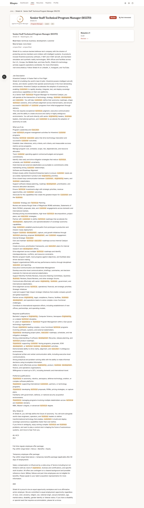

# Flow and stage actions

Every stage a job, resume, or application passes through has a way forward and a way out — no
stage is a dead end.

| Stage | Forward | Out |
|---|---|---|
| Job (grid, recommendations, job page) | **Tailor** | **Not interested** hides the job (`jobs.hidden_at`); Undo toast for 8 s; "Show jobs I hid" toggle on Jobs |
| Resume | **Review resume** → **Mark ready to send** → **Download and open the posting** | **Archive** (in the resume page's **More** menu) archives the package (`packages.archived_at`) and hides the job; **Regenerate** makes a new version; **Needs attention** lists what the truth check held back, each with a Fix link |
| Apply | Opens the posting in a new tab and downloads the resume; on return the card asks "Did you apply?" **Yes / Not yet / Skip** (Skip here archives the resume and hides the job) | Yes creates or updates the application as Applied with today's date |
| Your applications (Dashboard) | **Screen → Interview → Offer**, each with date and optional note | **Closed** with reason `rejected \| withdrew \| no_response \| filled`; **Follow-up** date puts a reminder on the Dashboard |

## Not interested

Not interested hides a job from the Jobs grid and the Dashboard's recommendations. It isn't a
permanent delete — a toast offers **Undo** for 8 seconds, and after that the **Show jobs I hid** toggle
on the Jobs page brings hidden jobs back into view (and lets you unhide one) at any time.

## Archive

Archive is the way out of a resume you don't want to pursue. It archives the package and hides the
underlying job in one step, with the same 8-second Undo toast as Not interested. You'll find it in
the **More** menu on the resume's page, and as **Skip** inside the "Did you apply?" prompt if you
decide not to after all.

## Needs attention

When the truth check rejects part of a generated resume, the package is marked **Needs attention**
(stored as `blocked`) instead of ready for review. No documents are offered until it is fixed. The
job page's main button reads **Fix and review**, and the resume's page lists every line that did
not pass - which rule failed, what to do about it, and where - each with a link that jumps straight
to the offending line or field so you can fix it and regenerate.

## Closed

An application is closed with one of four reasons, so a closed application always
says why:

- **Rejected** — the employer turned you down.
- **Withdrew** — you pulled out of the process.
- **No response** — the employer went quiet.
- **Filled** — the role was filled by someone else, or pulled entirely.

## Follow-up

Any application can carry a follow-up date. A follow-up due today or overdue puts a "Follow up"
badge on its row in the Dashboard's **Your applications** list, and due rows sort to the top of that
list. The Dashboard's next-step card offers **Update status** for the first one, so it doesn't sit
unnoticed.

## Closed postings and reposts

A job a source no longer returns on two consecutive polls is marked `unlisted_at`: it leaves the
recommendations and the Resumes queue, and any application tied to it shows "No longer listed".
When the same role reappears later — a repost — the new posting's `repost_of` links back to the
original. The new job's card and header carry a Reposted chip, and its page offers "Reuse resume
v{n}" so you don't have to tailor from scratch for a role you've already been through.
