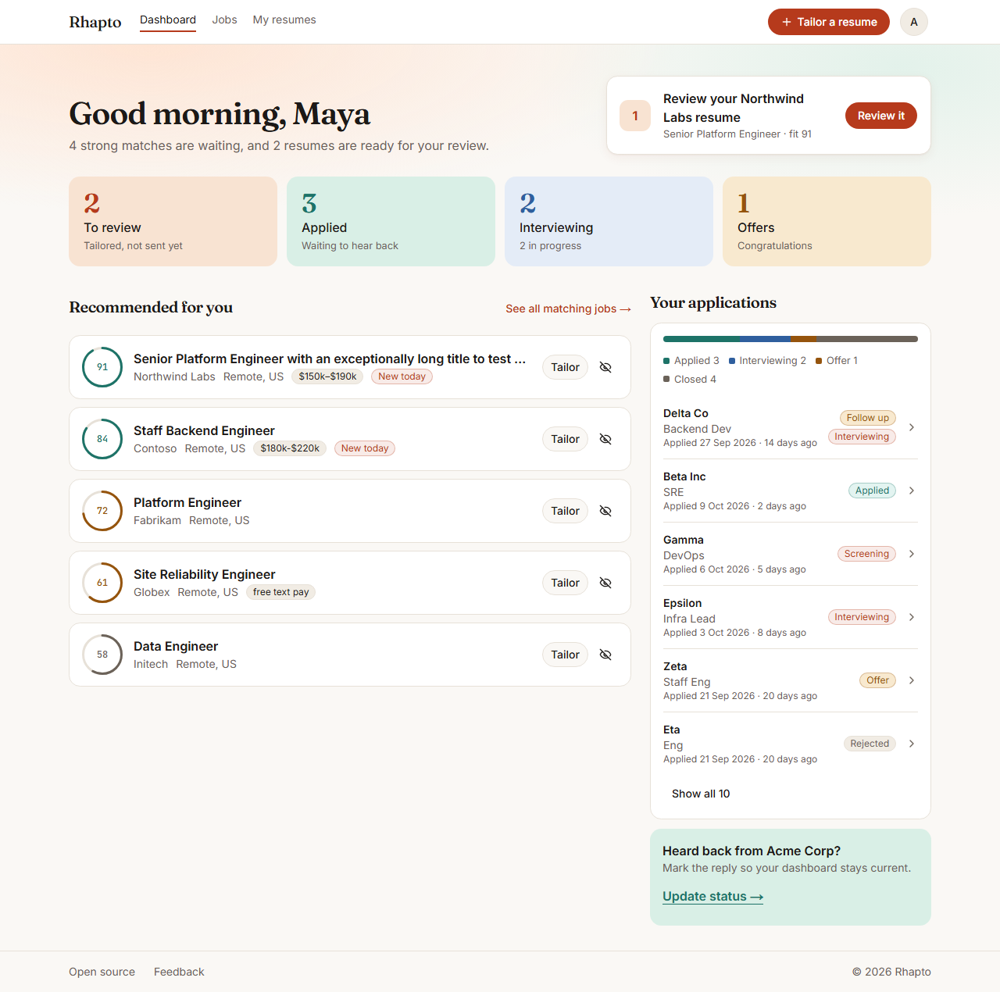

# Dashboard

The Dashboard (`/dashboard`) is where you land once signed in. It answers two questions: where do
my applications stand, and what should I apply to next. (`/` is the explainer, and it is shown
there to everyone, including you when you are signed in. Bookmark `/dashboard`.)

The page spans the full width of the header and has a warm band at the top.

## The greeting

The heading greets you by the time of day on your device (morning until noon, afternoon until 6 pm,
then evening) and your first name, for example "Good afternoon, Maya". Without a name it says
"Welcome back". Under it, one line says what is true right now: "5 strong matches are waiting, and 1
resume is ready for your review". A part with nothing behind it is left out, and when there is
nothing to say it reads "Here's where your search stands."

## Your next step

A card beside the greeting (below it on a phone) suggests one thing to do, the first that applies:

1. A resume waiting for review: "Review your Rigetti resume", with the role and fit, and **Review it**.
2. A follow-up that is due: "Follow up with Sunrun", with **Update status**, which opens that application.
3. Otherwise your best recommended job: "Tailor a resume for ...", with **Tailor**.

With nothing to suggest, the card is not shown.

## The four tiles

**To review** (opens the To review tab on My resumes), **Applied**, **Interviewing** and **Offers** show
the count and a short line beneath. The last three filter **Your applications** (on a phone they also
scroll you there); press the same one again to clear the filter.

## Finishing setup

If your resume file or the roles you want are still missing, one line says "N things to finish in
your profile" and links to Profile. You can dismiss it with the X, and it stays dismissed on that
browser.

## Your applications

On wide screens this is the narrower column on the right (below Recommended on a phone). A coloured
bar shows how applications split between applied, interviewing, offer and closed, with the counts
beneath it. Below are the six most recent rows; **Show all** reveals the rest. Each row shows the
company, the role, when you applied and how long ago, and a badge in plain words. Select a row to
open its sheet, where you change the status, add notes, set a follow-up, open the resume you used,
or delete the application. See "Tracking your applications" for the details.

When a tile is filtering the list, "Showing: Interviewing" appears with a **Show all** button to clear it.

A row with a follow-up due today or overdue carries a "Follow up" badge.

If an application is still "Applied" after a week or more and has no follow-up date, a green tip
under the list asks "Heard back from ...?" with **Update status**. It is not shown otherwise.

Before you have any applications, this area says your applications will show here once you tailor a
resume and mark it as applied, and the tiles show quiet zeros.

## Recommended for you

On wide screens this is the wider column on the left: the five best-fitting jobs that have no resume
and no application yet and are not hidden. Each shows a fit ring with the score, the role, the
company, the location, pay when known, and "New today" when the job was found in the last 24 hours.
**Tailor** starts a tailored resume for that job and takes you to the guided flow to follow it; the
eye button (**Not interested**) hides the job, with an Undo for a few seconds. **See all matching
jobs** opens the full list on Jobs, where **Check for new jobs** also lives.

If there is nothing to recommend yet, the section says Rhapto is finding jobs and offers **Paste a
job instead**.

## A brand-new account

With no resume uploaded and no applications, the Dashboard shows the greeting and a "Start with your
resume" card with an **Upload resume** button, and no tiles or lists.

## When a refresh fails

If the API cannot be reached, a banner says so under the greeting. A count that could not be loaded shows a dash instead of an untrue zero. Content you already have on
screen stays as it was; nothing is cleared out from under you.
