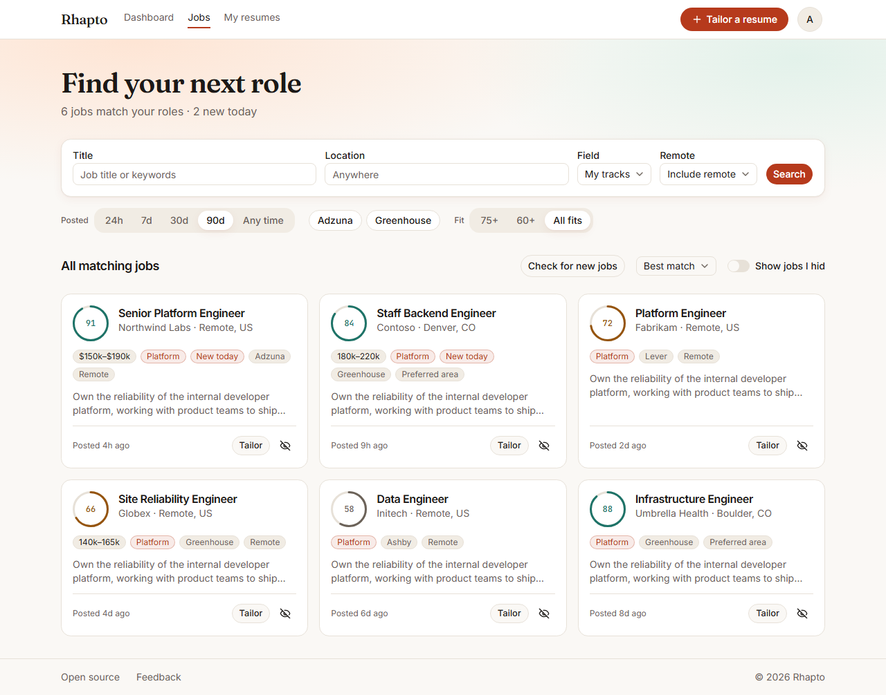

# Jobs and search

Jobs (`/jobs`) is where you search the whole market and browse everything Rhapto has found.

## The search form

The top of the page shows how many jobs match your roles (and how many are new today), then the
search form on a card: a free-text **Title**, a free-text
**Location** (it defaults to your home location when left blank), a **Field** select that defaults
to "My tracks" (score against your own roles rather than one field's generic keyword list), and a
**Remote** select (include, remote only, or exclude remote). Press **Search** to run a live search
across every enabled source; results stream back with unscored jobs showing a dashed ring until
the scorer catches up.

## Filters

Under the search form: **Posted** (24h, 7d, 30d, 90d, Any time) and **Fit** (75+, 60+, All fits),
each a row of options where one is picked, plus **Source** (one pill per enabled source,
multi-select). Work type and salary are deliberately not filters in this version — salary shows directly on a card when the
source provides it, but there's no way yet to filter the grid by it.

## Reading a card

Each job card shows a fit ring on the left (with the score, or a dashed ring and a dash if
unscored), then the title and a line with the company and location (the area label if the job has
no location). Below that, a row of pills: salary when the source provides it, the track it was
scored against, **New today** for jobs found in the last 24 hours, the source, an area label
(Preferred area / Remote / US / Abroad), and **Reposted** when the posting has reappeared after
being unlisted. At the bottom, "Posted {relative time}" sits beside the **Tailor** button and the
eye button that hides the job.

## While the rings are dashed

A freshly returned job that hasn't been scored yet shows `best_fit: null` and a dashed ring. The
page refetches those jobs every 3 seconds until every one has a score, for up to 60 seconds total.
If a job's ring is still dashed after that, scoring simply hasn't finished yet — the dash isn't an
error, and the ring fills in the next time you load the page.

## Sort, check for new jobs, Not interested

Above the grid, a **Sort** control switches between **Best match** (the default, which favours a
strong match posted recently), **Highest fit**, and **Newest**. **Check for new jobs** asks every
source for fresh postings now, without waiting for the regular schedule. **Show jobs I hid**
reveals jobs you have marked Not interested, and lets you bring one back. Not interested (the eye button at
the bottom right of a card) hides that job immediately, with an **Undo** toast that stays up for 8 seconds.

Browse jobs pages client-side, 24 per page, with **Previous** / **Next** and "Page X of Y" below
the grid. The current page is part of the URL, so the browser's Back button steps back through
pages one at a time rather than losing your place.

## Save this search

Once you've run a search with a query, a "Save this search" button appears next to the filters (it's
hidden once the current query is already saved). Saving turns the search into one Rhapto's worker
polls on its normal schedule going forward, and it starts tracking "N new" — new matches since you
last opened its results, shown next to the search in Settings → Saved searches; its name opens the results.

