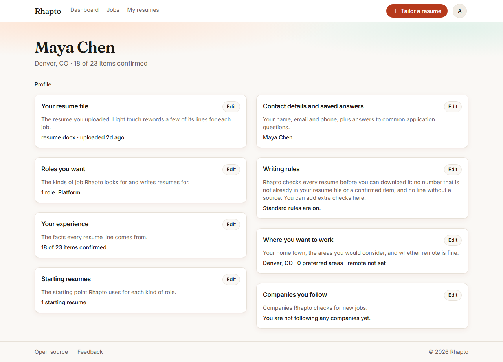

# Profile and roles you want

Profile (`/profile`) holds everything Rhapto needs to know about you, as eight summary cards in two
columns. Each card's **Edit** opens a sheet with the full editor; a card can be linked to directly
with `?card=<id>` (for example `/profile?card=tracks`; the card ids keep their old names) — the same links the Dashboard's finish-setup line
uses. Opening a sheet this way adds a step to your browser history, so the back button closes an
open sheet rather than leaving the page; pressing Back again afterward leaves the page as normal.

## The eight cards

- **Your resume file** - the `.docx` Light touch rewords a few lines of, and what Rhapto parsed from it.
- **Roles you want** - the roles Rhapto scores jobs against; see below.
- **Your experience** - your library of career facts, the source every Full rewrite line comes from.
- **Starting resumes** - named groupings of items and section order used to build a resume in Full
  rewrite.
- **Contact details and saved answers** - name, email, phone, location, links, and any other
  application-form answers Rhapto fills in verbatim.
- **Writing rules** - the checks every resume goes through; see below.
- **Where you want to work** - your home town, the areas you would consider, and whether remote is
  fine.
- **Companies you follow** - the company boards Rhapto polls directly; see below.

## Roles you want and the field picker

A role you want (a track) is what a job is scored against (see
[`../product/concepts.md`](../product/concepts.md#tracks)). The fastest way to create one is
**Pick a field and role**: choose one of twelve fields (Engineering, Data Science, Product, Program
and Project Management, Design, Marketing, Sales, Finance, Operations, People, Customer Success,
Other), then a role within it. Picking a role creates a track with that role's curated keywords and
a fit threshold of 60. If you've uploaded a resume, its parsed section titles are matched against
role names and offered as one-tap suggestion chips above the field/role grid — picking one skips
straight to that role. Once created, a track's name, keywords, and threshold all stay editable in
the same Roles you want card.

## Your experience and confirmed numbers

In Full rewrite, only an item you have confirmed (`verified: true`) may carry a number. The check
runs at generation time, so a number you have not confirmed is left out - the sentence stays, the
number goes. Confirm a number only once you are sure it is accurate, since doing so is what lets
Rhapto use it. In Light touch, a number must already be in your uploaded resume file.

## Writing rules

The Writing rules card lists the extra checks that run on every resume (Rhapto ships sensible
defaults; you can add, edit, or turn off the optional ones). Two checks always run and are not
switches: every line must have a source, and no number may be unconfirmed (not in your resume file,
or not a confirmed item). Turning off "no invented entities" prompts a confirmation first, since
it would allow companies, schools and tools that are not in Your experience.

## Where you want to work

Three answers drive fit's location multiplier: your home location, a comma-separated list of
preferred towns and regions, and whether remote roles are acceptable to you. Saving any of them
re-scores your queue immediately.

## Companies you follow

The Companies you follow card lists the company boards Rhapto polls directly — company, source (Greenhouse,
Lever, Ashby, Workday, or one with no adapter yet), the board identifier, and optional keywords.
Add a row by hand with **Add row**, or let Rhapto add one for you: when a live search turns up a
job hosted on a company's own ATS board, that board is added to your watchlist automatically. See
[`../product/sources.md`](../product/sources.md#auto-discovered-boards) for the URL patterns Rhapto
recognizes.
