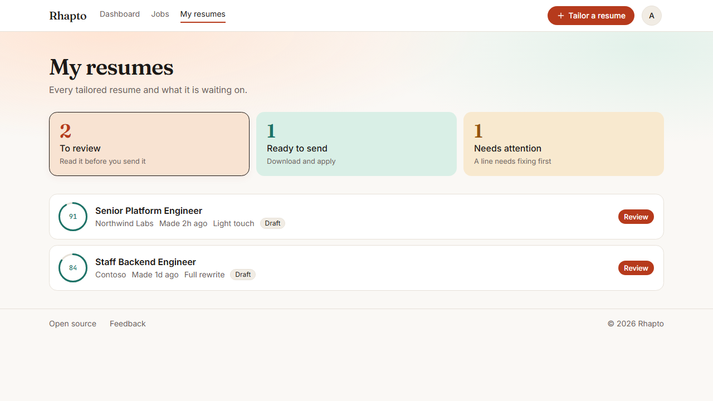
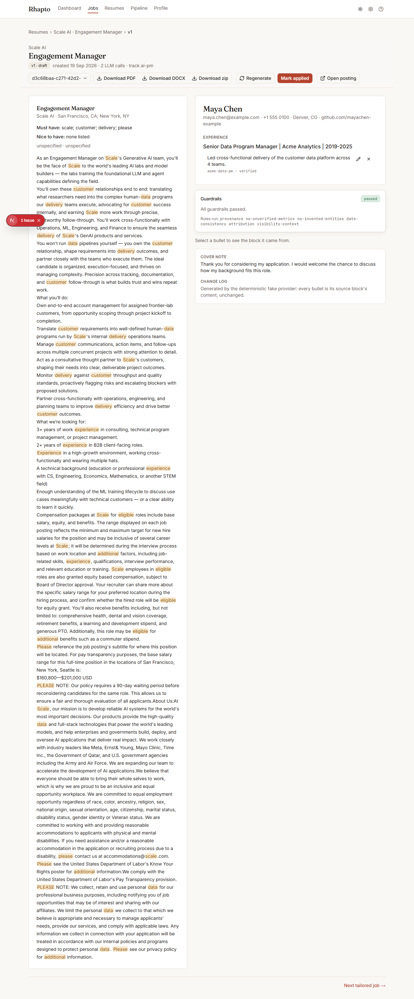

# My resumes

My resumes (`/resumes`) lists every tailored resume and what it is waiting on. It is the third tab
in the header, after Dashboard and Jobs.

## The three tabs

- **To review** - freshly tailored, not yet marked ready to send.
- **Ready to send** - you have reviewed it and marked it ready.
- **Needs attention** - the truth check held something back; it needs a fix before it can be ready.

There is no Applied tab. Once you have applied, follow that application on the Dashboard, under
**Your applications**; its sheet links back to the resume you used.

## Reading a row

Each row shows the company, the role, a fit ring, and a status badge. The whole row is one link to
the resume's page; the word at its right end says what to do next: **Review**, or **Fix** when the
truth check held the resume back.

## Review

A resume's page shows the job description alongside the resume. What you see depends on how it was
tailored:

- **Full rewrite** builds the resume from the items in Your experience. It shows the composed resume
  section by section; selecting any line shows the item it came from, so you can see exactly which
  fact it traces to.
- **Light touch** rewords a few lines of your own uploaded resume file. It shows the **Changes**
  pane: one card per paragraph that changed, each with a **Before / After** word-level diff - added
  words underlined, removed words struck through. You can edit any "After" directly (click into it
  to get a text box) and press **Save as new version**, which runs the truth check again and
  creates a fresh version rather than overwriting the one you are looking at.

Either way, the page also shows the cover note, the change log, and a list of what the truth check
looked at. A version switcher at the top lists every version with its status, for example "Version
2 - Ready to send".

## Mark ready to send

Once you are satisfied with a resume, press **Mark ready to send** on the resume's own page. It is
the one filled button there while the resume is still a draft. Marking it ready only changes its
status; Rhapto never submits anything to an employer.

When a resume is ready, the main button becomes **Download** (Word or PDF), and **I've applied**
sits next to it. On the job page, the main button becomes **Download and open the posting**
(or **Download resume** when the posting has no safe link).

## More

The **More** menu on the resume's page holds the less common actions:

- **Regenerate** opens a dialog where you can add feedback (10-500 characters), switch the track,
  and switch the mode - **Tune my resume** (Light touch, only offered once you have uploaded a
  resume file) or **Build from blocks** (Full rewrite). It re-tailors into a brand-new version
  rather than editing the current one.
- **Download everything** downloads the full package, including the check report.
- **Open the job posting** opens the employer's page in a new tab (not offered while the resume
  needs attention).
- **Archive** removes the resume from your lists and hides its job in one step. An **Undo** toast
  stays up for 8 seconds if you change your mind.

## Needs attention

A resume lands here when the truth check held something back. Rhapto does not offer documents for
it until it is fixed. The page lists every line that did not pass: which rule, a plain-words
message, what to do about it, and the exact place in the resume it applies to - click one to jump
straight to it. A number is held back, for instance, when it is not in your uploaded resume file
(Light touch) or not an item you confirmed in Your experience (Full rewrite); edit the line and save
a new version, or regenerate, to clear it. The panel also lists the checks that did run, such as
"Checked: provenance".

